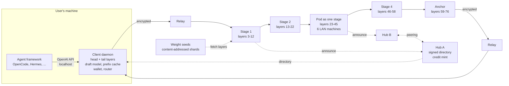

# Decentralized Frontier Inference Network

**Design v0.1, 5 November 2026 (section 15 and 17 runtime notes updated the same day after the prior-art check)**

A network that runs frontier-scale open-weight models (GLM-5.3 and Kimi K3 as the stated goals) across hardware owned by many people, exposes the result as an OpenAI-compatible API that agent frameworks such as OpenCode and Hermes can point at, and pays for itself through compute credits rather than money. Trust is hybrid: an open public swarm for capacity, plus pods of vouched-for peers for sensitive work. Coordination is federated. The design treats confidentiality and anonymity as first-class requirements and is explicit about where they can and cannot be guaranteed on consumer hardware.

---

## 0. Decisions made in this document

| Question | Decision | Why |
|---|---|---|
| Parallelism across the internet | Pipeline parallelism: each node runs a contiguous block of layers | Only one small vector crosses the network per token per hop. Tensor and expert parallelism need sub-millisecond links |
| Parallelism inside a pod (LAN or metro) | Pipeline by default, expert parallel allowed | Fast links make per-layer dispatch affordable, so a pod of small machines can present itself as one large stage |
| Where experts live on a standard node | Routed experts in system RAM, attention, shared experts and KV cache on the GPU | For MoE models the per-token weight traffic is only the active parameters. RAM bandwidth is enough for decode. The GPU does what RAM cannot: attention over long context and prefill compute |
| Launch model | GLM-5.3 at 4-bit (365 GB) | A single 512 GB Mac Studio, two 256 GB Mac Studios, four 128 GB Strix Halo boxes, or eight 64 GB desktops can hold one replica. Kimi K3 at usable precision needs 860 GB to 1.5 TB per replica and is a second-phase target served by anchor pods |
| Who runs the first and last layers | The user's own machine | The swarm never receives token embeddings or logits. This is the single largest privacy win available on consumer hardware, and it is the first useful job for GPU-less machines |
| Confidentiality from nodes that compute on your request | Architectural (depth, client-held layers, pod routing, cost asymmetry), not cryptographic | Section 9 explains why nothing stronger is available today and what the residual risk is |
| Anonymity | Relays between client and swarm, optional cloaked nodes, pseudonymous keys, blind-signed credits | No single party holds both an IP address and request content |
| Coordination | Federated hubs that publish signed node directories and run credit mints. Clients build their own routes | Hubs never see routes or content, cannot deanonymize by steering, and no single hub is a kill switch |
| Incentive | Compute credits issued as blind signatures for work done, spent to consume. No token, no money | Reciprocity is the stated goal. Blind signatures make earning and spending unlinkable |
| Runtime | ggml (llama.cpp lineage) for stage execution, Rust for everything network-facing | ggml is the only runtime with quantized GLM-5.3 and Kimi K3 across NVIDIA, AMD, Apple and CPU. Rust for a daemon that strangers connect to |

---

## 1. Goals, non-goals and constraints

**Goals**

1. Serve GLM-5.3 and, later, Kimi K3 through an OpenAI-compatible `/v1/chat/completions` endpoint with streaming and tool calling, usable as a drop-in provider for OpenCode, Hermes Agent and similar frameworks.
2. Anyone with hardware can join and earn access by serving. A machine without a GPU still has useful roles.
3. No single operator, hub or node can observe who is asking what. Nodes computing on a request should learn as little as physically possible about its content.
4. Survive node churn mid-generation without losing the conversation.
5. No dependency on any single hosting provider for weights, directories or credits.

**Non-goals for v1**

- Matching hosted-API latency. With speculative decoding, expect 3 to 6 tokens per second on the desktop tier, 7 to 10 on a Strix Halo pod, 15 or more on a remote anchor and 30 or more on an anchor on your own LAN.
- Cryptographic confidentiality against a node that holds model layers. See section 9.
- Resistance to a global passive adversary correlating traffic timing. An optional Tor ingress exists for users who need it and can accept its bandwidth.
- Vision input. Both target models are multimodal; v1 serves text only.
- Fine-tuning or training.

**Constraints that drive everything**

- Consumer internet latency between arbitrary peers is 20 to 60 ms one way. Metro-area peers are 2 to 5 ms. LAN is under 1 ms.
- Consumer upload bandwidth ranges from 20 Mbps (cable) to 1 Gbps (fiber). Prefill of long agent contexts is bandwidth-heavy.
- Consumer memory bandwidth ranges from 60 GB/s (DDR5 desktop) through 215 GB/s (Strix Halo) to 1.2 TB/s (M5 Ultra). Decode speed is governed by this.
- Both target models are open weights with custom licenses. Redistribution terms must be checked before shipping shards.

---

## 2. Target models

Figures below come from the official `config.json` files and model cards on Hugging Face and from the Unsloth GGUF repositories. Active-parameter counts marked "derived" are computed from the config, since the GLM card does not state one.

### 2.1 GLM-5.3 (zai-org/GLM-5.3)

| Property | Value |
|---|---|
| Total parameters | 753B |
| Active per token | about 43B (derived: 8 routed experts plus 1 shared across 75 MoE layers, plus attention, dense layers and embeddings) |
| Layers | 78 (layers 0 to 2 dense, 3 to 77 MoE) plus 1 multi-token-prediction layer |
| Hidden size | 6144 |
| Experts | 256 routed, 1 shared, 8 routed selected per token, expert intermediate size 2048 |
| Parameters per expert | about 37.7M (three 6144 by 2048 matrices) |
| Attention | MLA with DeepSeek Sparse Attention indexer. kv_lora_rank 512, rope dim 64, 64 heads. Indexer: 32 heads by 128 dims, top-k 2048 |
| KV cache per token per layer | 1152 bytes in bf16 (576 bytes in FP8) plus roughly 128 bytes of indexer keys |
| Vocabulary | 154,880 |
| Context | 1,048,576 |
| Native weights | FP8, 756 GB |
| License | Custom "glm-5.3" license. Secondary sources report a security-review clause for model-as-a-service businesses above 10 billion dollars in revenue. Read the LICENSE file before distributing shards |

GGUF sizes (unsloth/GLM-5.3-GGUF): IQ1_S 217 GB, IQ2_M 239 GB, Q2_K_XL 254 GB, IQ3_XXS 282 GB, Q3_K_XL 343 GB, **IQ4_XS 365 GB**, Q4_K_XL 467 GB, Q8_0 801 GB, BF16 1.51 TB.

### 2.2 Kimi K3 (moonshotai/Kimi-K3)

| Property | Value |
|---|---|
| Total parameters | 2.8T |
| Active per token | 104B (stated by Moonshot) |
| Layers | 93 (1 dense, 92 MoE). 69 are Kimi Delta Attention (linear attention), 24 are gated MLA (every fourth layer plus the last) |
| Hidden size | 7168, 96 heads |
| Experts | 896 routed, 2 shared, 16 routed selected per token. Latent MoE dimension 3584, expert intermediate 3072 |
| Parameters per expert | about 33M |
| Attention state | MLA layers: kv_lora_rank 512, rope dim 64, so 1152 bytes per token per MLA layer in bf16. KDA layers hold a fixed-size recurrent state of roughly 3 MB per layer per sequence regardless of context length |
| Vocabulary | 163,840 |
| Context | 1,048,576 |
| Native weights | MXFP4 experts with bf16 attention, 1.56 TB |
| Multi-token prediction | Present (benchmarked by third parties with MTP on and off) |
| License | "Kimi K3 License" (3 KB LICENSE file). Read before distributing |

GGUF sizes (unsloth/Kimi-K3-GGUF): Q1_0 466 GB, TQ1_0 509 GB, TQ2_0 551 GB, IQ1_S 594 GB, IQ1_M 649 GB, IQ2_XXS 711 GB, **Q2_K_XL 861 GB**, **Q4_K_XL 1.51 TB**, Q8_K_XL 1.56 TB. Running K3 currently requires Unsloth's llama.cpp fork; the upstream pull request was still open as of August 2026.

### 2.3 What the architectures imply

- **Memory traffic per decoded token** is the active parameters times bytes per parameter. GLM-5.3 at IQ4_XS reads about 21 GB per token. Kimi K3 reads 32 GB at Q2_K_XL and 56 GB at Q4_K_XL. This number, divided across stages and by each stage's memory bandwidth, is the decode floor.
- **Routed experts dominate the bytes but not the per-token traffic.** In GLM-5.3, experts are 724B of the 753B total but only 25B of the 43B active. Attention plus shared parts are 18B active. This is why experts can sit in slow system RAM while attention sits on the GPU.
- **Per-session state is modest.** A 20k-token GLM-5.3 conversation holds about 1.1 GB of FP8 KV and indexer cache across the whole swarm, roughly 140 MB per stage in an 8-stage pipeline. Kimi K3 holds less, about 0.5 GB, because most of its layers are linear attention.
- **Both models have an MTP head**, which is the cheapest speculative decoding available: the pipeline verifies two tokens per pass for almost the same memory traffic as one.
- **GLM-5.3's first three layers are dense**, roughly 1.25B parameters. They fit on any client machine. This makes the client-held head cheap for the launch model. Kimi K3's first layer is also dense, but its last layer is a full MoE layer of 29.6B parameters, which changes the client-tail story (section 9.3).

---

## 3. The physics budget

Every design choice below is checked against these four budgets. Assumptions: WAN hop 30 ms one way, LAN hop 1 ms, chunked prefill in 4k-token chunks, FP8 activations between stages. A route with N stages costs N plus 1 hops per token (the last stage returns to the client) plus about 30 ms of relay overhead over the WAN. Anchors are compute-bound at roughly 45 ms per token rather than memory-bound, so their rows use that figure.

### 3.1 Decode: GLM-5.3 at IQ4_XS (365 GB replica, about 21 GB read per token)

| Configuration | Nodes | Memory per node | Weight-read time, summed | Decode over LAN | Decode over WAN |
|---|---|---|---|---|---|
| Mac Studio M5 Ultra 512 GB | 1 | 365 GB | 17 ms (compute-bound near 45 ms) | 20 to 25 tok/s | about 7.5 tok/s |
| Mac Studio 256 GB pair | 2 | 183 GB | 17 ms (compute-bound near 45 ms) | about 20 tok/s | about 6 tok/s |
| Strix Halo 128 GB (215 GB/s) | 4 | 91 GB | 97 ms | about 10 tok/s | about 3.6 tok/s |
| Desktop, 64 GB DDR5 plus 12 to 16 GB GPU, experts in RAM | 8 | 46 GB | 216 ms | about 4.4 tok/s | about 1.9 tok/s |
| Desktop, 64 GB DDR5, no GPU (everything in RAM) | 8 | 46 GB | 347 ms | about 2.8 tok/s | about 1.5 tok/s |
| Desktop, 32 GB plus GPU | 16 | 23 GB | 220 ms | about 4.2 tok/s | about 1.3 tok/s |

Multiply by about 1.8 with MTP at the acceptance rates reported for well-matched DeepSeek-style heads (80 to 90 percent), and by 2 to 3 with a client-side draft model on top. The desktop WAN tier therefore lands at 3 to 6 tokens per second for an agent, the Strix Halo pod at 7 to 10, a remote anchor at 15 or more, an anchor on the user's own LAN at 30 or more. Add the client's own head and tail to every row: about 3 ms on a GPU, about 30 ms on a CPU-only laptop.

Two things to notice. Summed weight-read time does not improve when you add CPU nodes, because the total bytes read per token is fixed. And the WAN penalty is one hop per stage, so fewer, fatter stages always win. These two facts are the whole case for anchor nodes and for pods that present as one stage.

### 3.2 Decode: Kimi K3

| Configuration | Quant | Nodes | Memory per node | Weight-read time, summed | LAN | WAN |
|---|---|---|---|---|---|---|
| Mac Studio 512 GB | Q2_K_XL (861 GB) | 2 | 430 GB | 27 ms (compute-bound near 45 ms) | about 20 tok/s | about 6 tok/s |
| Mac Studio 512 GB | Q2_K_XL | 3 | 287 GB | 27 ms (compute-bound near 45 ms) | about 20 tok/s | about 5 tok/s |
| Mac Studio 512 GB | Q4_K_XL (1.51 TB) | 4 | 378 GB | 47 ms | about 18 tok/s | about 4.3 tok/s |
| Strix Halo 128 GB | Q2_K_XL | 8 | 108 GB | 150 ms | about 6 tok/s | about 2.2 tok/s |
| Desktop 64 GB plus GPU | Q2_K_XL | 16 | 54 GB | 300 ms | about 3.1 tok/s | about 1.2 tok/s |

Kimi K3 at the quality people want (Q4) is a four-anchor model. At Q2 it is a two-anchor model or an eight-box Strix Halo pod. On the desktop tier it is a 1 to 2 token-per-second experience even with MTP. That is why it is phase 3, not launch.

### 3.3 Prefill: first-token latency on a cold 20k-token context

Prefill is compute-bound, not memory-bound, and the two target models cost 86 and 208 GFLOP per token respectively. A cold 20k-token GLM-5.3 context is 1.7 PFLOP.

| Configuration | Bottleneck | Cold 20k-token prefill | Warm turn adding 2k tokens |
|---|---|---|---|
| 8 desktops with 4090-class GPUs | Streaming 44 GB of expert weights per stage per chunk over PCIe, 2 s per chunk-stage | 25 to 30 s | 2 to 3 s |
| 4 Strix Halo | GPU compute, about 25 effective TFLOPS each | about 30 s | about 3 s |
| 1 Mac Studio M5 Ultra | GPU compute | 20 to 60 s (M5 Ultra throughput for this workload is not yet well characterized) | 2 to 6 s |
| Kimi K3, any tier | 2.4 times the FLOPs | 60 to 70 s | 6 to 7 s |

Agent frameworks resend the entire conversation on every turn. The OpenAI API is stateless, so the client daemon must recognize that a new request shares a prefix with a live session and send only the delta (section 6.4). Without prefix caching the network is unusable for agents. With it, only the first turn is slow.

### 3.4 Bandwidth

| Flow | Size | Time at 100 Mbps up | Time at 20 Mbps up |
|---|---|---|---|
| One decode token between stages, FP8 hidden state, GLM-5.3 | 6 KB | negligible | negligible |
| Cold 20k-token prefill between stages, FP8 | 123 MB per hop | 10 s (overlapped with compute across chunks) | 50 s per hop, unusable |
| Client to first stage, same | 123 MB | 10 s | 50 s |
| Per-stage session replay log (section 7) | 123 MB per 20k tokens | shipped only on failover | |

Node requirement: 100 Mbps upload minimum for pipeline roles, 500 Mbps preferred. A 20 Mbps node can still relay, seed weights or host a draft model (section 5). BloomBee's lossless byte-split compression gets bf16 activations to 46 percent; on FP8 activations expect 15 to 25 percent savings, worth having but not transformative.

### 3.5 Session state

| Model, 20k-token session | Across the swarm | Per stage, 8 stages |
|---|---|---|
| GLM-5.3, FP8 KV plus indexer cache | about 1.1 GB | about 140 MB |
| Kimi K3, FP8 KV plus KDA state | about 0.5 GB | about 60 MB |

A standard node reserving 8 GB for session state holds 50 or more concurrent 20k-token sessions. Batching those sessions in one decode step is the economic engine of the network (section 11.4): memory traffic for a batch of 8 is barely more than for a batch of 1, so a node's earning rate scales with concurrency.

---

## 4. Architecture

**Five kinds of participant**

| Participant | Runs | Sees |
|---|---|---|
| Client daemon | Embedding, first dense layers, last layer, LM head, MTP or draft model, prefix cache, route selection, credit wallet, OpenAI-compatible server on localhost | Everything about its own user, nothing about anyone else |
| Stage node | A contiguous layer range of one model, KV cache for live sessions, replay log of its outputs | Hidden states for its layers, a per-session pseudonym, the IP of its two neighbors (or of relays, if neighbors are cloaked) |
| Pod | A set of mutually vouched nodes on a fast network, presenting one or more stages. May use expert or tensor parallelism internally | What its member stages see |
| Relay | Dumb encrypted forwarding between client and first or last stage, and introduction points for cloaked nodes | Client IP and an opaque session token. No content, no route |
| Hub | Signed node directory (like a Tor consensus), credit mint, peering with other hubs | Node announcements and pseudonymous credit redemptions. No routes, no content, no client IPs if the client reaches it via a relay |

**What never exists in one place**

No participant holds both a client IP and request content. No participant holds both a route and content. The hub, which is the most natural point of control, is designed to be unable to steer a user onto attacker nodes because it never assigns routes; it only publishes a signed list that clients choose from.

---

## 5. Node classes

| Class | Hardware | Role | Example GLM-5.3 slice |
|---|---|---|---|
| Anchor | 256 GB or more of high-bandwidth memory: Mac Studio 256 or 512 GB, DGX Spark pairs, multi-GPU rigs with 512 GB RAM | Backbone stages. Fewer hops for everyone | Half or all of a replica |
| Standard | 64 to 128 GB DDR5, GPU with 8 GB or more VRAM, 100 Mbps or more upload | Pipeline stages with experts in RAM, attention and KV on GPU | 1/8 to 1/4 of a replica (46 to 91 GB) |
| Light | Anything with a network connection, including GPU-less laptops and low-upload connections | Relay, weight seed, hub directory mirror, shared draft-model host | none |
| Client | 16 GB RAM minimum for the GLM-5.3 head and tail; 32 GB to also run the MTP layer locally | Privacy-critical layers, routing, wallet | head (about 2.5 GB) and tail (about 6.7 GB) |

**The GPU-less question, answered concretely.** A GPU-less machine cannot usefully hold a pipeline stage of a frontier model over the WAN (section 3.1: it makes every token slower and adding more of them makes it worse). It can do four things that the network genuinely needs, and it earns credits for each:

1. Run the user's own head and tail layers. Per-token cost on a 60 GB/s laptop is about 30 ms. This is where the privacy comes from.
2. Relay. Relays are the anonymity layer and need upload bandwidth, not compute.
3. Seed weights. A replica is 365 GB to 1.5 TB and must be distributed without depending on Hugging Face.
4. Host a shared draft model (a 1B to 3B model) for clients that cannot run one locally. The draft runs at the first stage so it adds no extra hop.

A GPU-less machine with 128 GB or more of RAM can additionally join a pod as an expert host (section 6.2), because inside a LAN the per-layer dispatch cost is affordable.

---

## 6. Execution model

### 6.1 Stages

A stage is a contiguous layer range of one model at one quantization. The node loads the GGUF tensors for those layers only, via content-addressed shards (section 13). For each live session it holds the KV and indexer cache for its layers plus a replay log of its output hidden states (section 7).

A decode step at a stage: receive a batch of FP8 hidden states (one per active session in this micro-batch), dequantize to bf16, run the layers with experts read from RAM and attention on the GPU, quantize the output to FP8, forward to the next stage. Memory traffic is the active expert bytes for this stage plus attention weights plus KV reads; compute is small at batch sizes under 16.

Standard nodes should run the attention, shared experts and KV cache on the GPU and routed experts in pinned system RAM, following the KTransformers and ik_llama.cpp pattern (`-ot exps=CPU`). Anchors with unified memory run everything in place.

### 6.2 Pods as virtual stages

A pod is a group of nodes with mutual vouching and low latency to each other. From the outside it announces one or more stages. Inside, it may split a stage's layers by expert parallelism (each member holds a subset of experts for all the pod's layers) or by tensor parallelism. The pod's ingress node receives hidden states from the previous stage, drives the internal dispatch, and emits the stage output.

Why this matters: six 64 GB desktops on one LAN cannot individually hold a useful slice of Kimi K3, but as a pod they hold 384 GB and present a single stage. Metro-area pods (2 to 5 ms between members) work for pipeline-inside-pod; expert parallelism needs true LAN.

Pods are also the trust unit (section 9.4) and the privacy unit for sensitive requests.

### 6.3 Prefill and decode

Prefill is chunked at 4k tokens. Each chunk flows through the pipeline as a unit so that stage compute and inter-stage transfer overlap across chunks. On standard nodes, prefill streams expert weights from RAM to GPU per chunk (the same batching trick KTransformers uses), which is why 100 Mbps upload and PCIe 4.0 x16 both appear in the node spec.

Decode runs in micro-batches across sessions. A stage waits at most 10 ms to accumulate hidden states from multiple sessions before running a step. This is what lets a node earn from several users at once for roughly the cost of serving one.

### 6.4 Prefix caching and session affinity

The OpenAI API is stateless. The client daemon hashes the token sequence of each request and matches it against live sessions it owns. A request whose token prefix matches a live session continues that session: the daemon sends only the new tokens, and every stage extends its existing KV. This turns a 25-second cold prefill into a 2-second warm one and is mandatory for agent workloads.

Consequences: sessions are sticky to their route for their lifetime, which trades some unlinkability for speed (a stage can see that a pseudonymous session continues, though not who it belongs to). Users can set a maximum session lifetime or force rotation per turn in sensitive mode at the cost of re-prefill.

### 6.5 Speculative decoding

Three layers of it, all compatible with the pipeline because verification of k tokens costs almost the same memory traffic as one:

1. **MTP head.** Both models ship one. The client daemon runs it as part of the tail (GLM-5.3's MTP layer is about 4.8 GB at 4-bit) and proposes one extra token per step. Expect 1.7 to 1.9 times decode throughput if the head is matched to the checkpoint; a mismatched head gave only 39 percent acceptance in one community report on Kimi K2.5, so this must be measured.
2. **Client draft model.** A 1B to 3B model on the user's machine proposes k tokens (k of 4 to 8). The pipeline verifies all k plus one in a single pass. For code, acceptance of 2 to 3 tokens per pass is typical. Combined with MTP this is where the desktop tier reaches 5 to 6 tokens per second.
3. **Lookahead decoding** (no draft model) as a fallback for clients with no spare memory, following the approach in arXiv 2602.16760, which measured 8 to 9 tokens per second for a 7B model over an 80 ms RTT link using it.

### 6.6 Activation format

FP8 (E4M3) hidden states between stages, with per-tensor scaling. BloomBee-style lossless byte-split plus zstd on top when the link is below 500 Mbps. All inter-stage and client-relay traffic is encrypted end to end between the two endpoints of each hop (Noise or TLS 1.3 over QUIC), so relays and network observers see only ciphertext.

---

## 7. Session state and failure handling

Each stage keeps, per live session: its KV and indexer cache (section 3.5) and a **replay log** of the FP8 hidden states it has emitted, about 6 KB per token. The replay log is the failover mechanism.

When stage i+1 disappears mid-generation:

1. The client daemon notices a missed heartbeat or a failed forward and consults its route alternatives (section 8). It picks a replacement node holding the same layer range.
2. Stage i replays its logged outputs for the session to the replacement, which recomputes its own KV for just those layers. For a 20k-token session this is 123 MB of transfer and one prefill of the stage's layers only, a few seconds on a standard node.
3. Generation resumes. The user sees a pause, not a failure.

Petals and BloomBee recompute from the client, which means re-running every earlier stage. Replay logs make failover local to the failed stage.

Planned departure: a node that wants to leave announces it, and the scheduler migrates its sessions by shipping KV directly to the replacement (140 MB per 20k-token session for GLM-5.3), which is cheaper than replay.

Replay logs and KV are deleted when a session ends or after an idle timeout the client chooses (default 30 minutes). Nodes never persist session state to disk.

---

## 8. Routing and placement

**Directory.** Each hub publishes, every few minutes, a signed directory of node announcements: public key, model and layer range held, quantization, memory headroom, measured upload bandwidth (verified by relays during admission), network coordinates (Vivaldi-style latency coordinates against a set of landmark relays), reliability score, cloaked flag, pod membership, and the hub's reputation record for the node. Light nodes mirror directories so a hub outage does not stop routing.

**Client-side route construction.** The client daemon, not the hub, builds routes. Given the directory, it solves a shortest-path problem over stage candidates: minimize the sum of per-stage service time (slice bytes divided by node bandwidth, plus a prefill estimate) and link latency (from coordinates), subject to layer coverage, memory headroom for the session, minimum reputation, and the user's privacy constraints (pod-only, no-cloaked-nodes-for-speed, and so on). BloomBee's dynamic-programming layer assignment solves this in under a millisecond for 8 stages over 80 layers; the client does the same with precomputed candidates. It keeps two backup routes per stage for failover.

**Placement incentives.** Nodes choose what layers to hold, but the directory shows coverage gaps and the credit rate (section 11) pays a premium for under-served layer ranges and for anchors that reduce hop count. Over time this converges toward few, fat, well-placed stages without a central scheduler.

**Geography.** Routes prefer stages that are close to each other in latency space, not close to the client. A pipeline that bounces across an ocean on every hop is the failure mode; a pipeline that stays within one continent and returns to the client once is fine.

---

## 9. Confidentiality: what nodes can learn about requests

This is the requirement the user ranked highest, and it is the one where honesty matters most.

### 9.1 What the research says

A node that holds layers of an open-weight model and receives hidden states can, with effort, reconstruct the input text. The relevant 2025 and 2026 results:

- **ActInv** (arXiv 2605.23158, 2026): with white-box access to the model, optimizing input embeddings to match intercepted activations recovers tokens at 99.8 percent precision when the client holds 2 of 28 blocks of Qwen3-0.6B, and still 77.7 percent when the client holds 7 of 28. Across Qwen3 0.6B through 30B, with the client holding 5 blocks, precision is 99.8 to 100 percent. The authors' summary: vanilla split inference provides little practical privacy.
- **Depth Gives a False Sense of Privacy** (arXiv 2507.16372): deep-layer states still leak prompts under optimization-based inversion.
- **Defenses evaluated so far:** Gaussian noise only helps at levels that also destroy model output. Permutation-based schemes are broken (arXiv 2505.18332). Rotation-based schemes (arXiv 2606.16461) require retraining a modified architecture and so do not apply to Kimi K3 or GLM-5.3 as released. The authors' own adversarially calibrated perturbation, PriPert, cut reconstruction to about 37 percent precision at a measurable utility cost and 4 times the client overhead, and they say it "does not eliminate" the leak.
- Fully homomorphic encryption and multi-party computation remain thousands of times too slow for models of this size. Hardware enclaves that cover GPUs exist only on datacenter parts; consumer GPUs have none.

So: **confidentiality of request content from a node that computes on it cannot be guaranteed on consumer hardware today.** The design does everything that is available, states the residual risk plainly, and gives users a mode that removes untrusted nodes from the path.

### 9.2 What the design does

| Mechanism | What it buys | What it does not buy |
|---|---|---|
| Client holds embedding, first dense layers, final layer and LM head | No node ever sees token IDs, embeddings or logits. Output tokens are never on the wire. Attacks must go through optimization-based inversion rather than lookup | Does not stop inversion; raises its cost from trivial to minutes of GPU time per prompt |
| Privacy depth: client holds additional MoE layers | Each GLM-5.3 layer the client adds costs 4.8 GB of RAM but only about 30 MB of per-token reads. A 64 GB client can hold 13 layers (17 percent of depth) | ActInv still recovered 78 percent at 25 percent depth on a small model. Depth helps at the margin, not in kind |
| Cost asymmetry | Inverting one 1k-token prompt costs a stage node on the order of 2000 optimization iterations over its layers, roughly 5 minutes on a 4090. Serving it costs milliseconds. A node cannot invert all traffic it serves | A node can invert a targeted session. Treat exposure as "a malicious node can read prompts it chooses to attack" |
| Per-session pseudonyms and relayed ingress (section 10) | Even a node that inverts a prompt does not learn whose it is, and cannot join it to that user's other sessions | Does not hide content |
| Pod-only mode | Sensitive requests route only through pods the user has vouched for. The threat becomes "a friend's machine is compromised" rather than "a stranger is curious" | Capacity limited to trusted pods; may mean a smaller model or slower speed |
| Optional perturbation (PriPert-style) at the client-swarm boundary | Reduces reconstruction further for users who accept a quality cost | Research-grade; must be benchmarked on these models before offering |
| Optional chaff | The client interleaves decoy requests, so a node cannot tell which of several sessions is real | Costs the user credits proportional to the chaff |

The product must state this to users in plain words at setup: *nodes in the public swarm can, with effort, read what you send them. Use pod-only mode for anything you would not paste into a stranger's chat window.*

### 9.3 The client head and tail, concretely

**GLM-5.3**

| Piece | Parameters | Size on client | Per-token read |
|---|---|---|---|
| Embedding table | 0.95B | 1.9 GB bf16 or 0.95 GB int8 | one row |
| Layers 0 to 2 (dense) | 1.25B | 0.6 GB at 4-bit | 0.6 GB |
| Layer 77 (MoE, all 256 experts resident) | 9.9B | 4.8 GB at 4-bit | 0.3 GB (8 experts plus attention) |
| Final norm and LM head | 0.95B | 1.9 GB bf16 or 0.95 GB int8 | 0.95 GB |
| MTP layer (optional) | 9.9B | 4.8 GB | 0.3 GB |
| **Total** | | **about 8 GB without MTP, 13 GB with** | **about 1.85 GB per token: 30 ms on a 60 GB/s laptop, 2 to 4 ms on a GPU** |

A 16 GB laptop with no GPU runs the head and tail. The swarm receives layer-3 inputs and returns layer-77 inputs.

**Kimi K3**

The head is cheap (embedding 2.35 GB, dense layer 1 about 0.6 GB). The tail is not: layer 93 is a full MoE layer of 896 experts, about 15 GB at 4-bit, plus a 2.35 GB LM head. Clients with 32 GB can hold it. Clients that cannot fall back to holding only the LM head, which means the last stage sees final hidden states that are close to logits, and the design requires that last stage to be a pod the user trusts or an anchor with high reputation. This is a real asymmetry between the two target models and should be shown to the user.

### 9.4 Pods and vouching

A pod is created by one operator and grown by invitation. Each member signs a vouch for each other member. The client daemon keeps a list of pod identities the user trusts, with a trust level per pod. "Pod-only" routes use only stages from trusted pods. "Pod-preferred" routes use trusted pods where available and fill gaps from the public swarm, and the daemon tells the user which stages were public.

---

## 10. Anonymity: who is asking and who is serving

### 10.1 Threat model

| Adversary | Learns | Does not learn |
|---|---|---|
| A stage node | Hidden states for its layers, a session pseudonym, the addresses of its two neighbors (or their relays) | Client IP, client identity, other sessions of the same user, the route beyond its neighbors |
| A relay | Client IP, an opaque session token, the address of the first or last stage it forwards to | Content, route, pseudonym |
| A hub | Node announcements, pseudonymous credit redemptions, directory downloads (by relay IP if the client uses one) | Routes (built client-side), content, which credits belong to whom (blind signatures) |
| A neighbor of a cloaked node | The relay's address | The cloaked node's IP |
| Hub plus first stage colluding | Can correlate a pseudonym's directory fetch timing with a session start | Still no IP if the client used a relay for the directory fetch as well |
| Global passive observer | Timing correlation across the client, relays and stages | Content |

### 10.2 Mechanisms

- **Pseudonymous identities.** Every client and node is an Ed25519 key. Clients rotate a per-session key derived from a master key; nodes keep a long-lived key for reputation. No email, no account.
- **Relayed ingress and egress.** The client reaches the first stage through a relay and receives the last stage's output through a relay (the same one by default, different ones in strict mode). Relays see IP and ciphertext. One relay hop adds 15 to 30 ms each way, which is acceptable against a pipeline that already has 8 hops.
- **Cloaked nodes.** A node operator who does not want neighbors to learn their IP keeps persistent outbound QUIC connections to two relays and is reachable only through them, like a Tor onion service. Each cloaked link adds one relay hop; the router accounts for it. Cloaked nodes earn the same credits as direct nodes, so the choice is purely the operator's.
- **Directory fetches via relay.** So the hub does not learn client IPs.
- **Tor ingress option.** For users who need resistance to a global observer, the client can reach relays over Tor. Tor circuits typically deliver a few to tens of megabits per second, so a cold 20k-token prefill takes minutes; warm turns are fine. Nym-style mixnets add seconds of latency per hop and are not suitable for interactive use.
- **No logs by design.** Relays and nodes keep no persistent record of sessions. Hubs keep only what the mint needs (spent-token lists) and node reputation.

### 10.3 Residual risks

A hub that is also a relay that is also a first stage would be a single party seeing IP, pseudonym and hidden states; the directory flags operators that run multiple roles, and the client router refuses to use one operator's nodes in more than one role on the same route. Timing correlation by a well-placed network observer is not defended against outside Tor mode. Node operators' legal exposure is discussed in section 17.

---

## 11. Credits

### 11.1 Unit

One credit is the work of serving one token through one reference stage, defined as one eighth of GLM-5.3 at IQ4_XS. Serving a Kimi K3 stage of equivalent width earns about 2.7 credits per token, in proportion to active bytes read. Consuming one GLM-5.3 token costs 8 credits (the whole pipeline) at any route length; the hub's per-stage reward scales so that a 4-anchor route and a 16-desktop route both distribute 8 credits per token across their stages in proportion to work done. Prefill tokens cost the same as decode tokens.

Multipliers: reliability score from 0.5 (new or flaky) to 1.2 (long uptime, low failure rate); coverage premium up to 1.5 for under-served layer ranges; the client pays the base rate regardless, and the mint absorbs the difference as the network's shared subsidy for coverage and reliability.

Light roles: relays earn 1 credit per 10 MB forwarded, seeds earn 1 credit per 100 MB served, draft-model hosts earn per draft token accepted.

### 11.2 Earning and spending without being linked

Credits are Chaumian e-cash. The hub runs a mint, in the style of the Cashu protocol: when a node finishes a verified unit of work, the hub blind-signs a token the node generated, so the hub can later recognize the token as valid but cannot tell which node earned it. The node's wallet holds tokens. To consume, the client's wallet presents tokens to the stages on its route (through the relay), the stages redeem them with the mint, and the mint checks the spent list. Earning identity and spending identity are cryptographically unlinked. The Cashu Development Kit (Rust) is a usable starting point; the unit changes from satoshis to credits and the Lightning backend is removed.

A node's reputation record is public under its node key; its credit balance is not.

### 11.3 Verified work

A stage is paid when the next stage acknowledges receipt of plausible hidden states for a token (norm and finite-value checks) and, for a sampled fraction of tokens, when a redundant execution on a second node agrees (section 12). A stage that fails redundancy checks forfeits the sampled payments and loses reputation. The client pays for a token when it receives the final hidden state; disputes resolve against the stage with the worse redundancy record.

### 11.4 The economics

A standard node in an 8-stage pipeline earns one credit per token the pipeline generates. If that pipeline runs at 3 tokens per second with one session, the node earns about 260k credits per day, which buys about 32k GLM-5.3 tokens of its owner's own use. A heavy agent user generating 50k tokens a day needs about 400k credits a day. One node serving one session does not cover a heavy user.

Batching changes this. The same node serving 8 concurrent sessions reads expert weights once per micro-batch, so it earns roughly 8 times the credits for about 1.3 times the memory time. At realistic utilization the credit economy balances when the average participant serves more than they consume, which is true of any reciprocity network, and the subsidy pool (section 11.1) covers the gap for coverage and reliability. The network should publish its aggregate earn-to-spend ratio so participants can see whether it is sustainable.

### 11.5 Bootstrapping

The first pods are launched by people who want the network to exist and are gifted a starting balance. New users receive a small sign-up balance (enough for an evening of use) tied to proof of a running node, so that the first experience is "it works" rather than "serve for a day first". Credits never expire, but a balance cap per pseudonym (large enough not to matter for honest users) limits hoarding by sybils.

### 11.6 Federation

Hubs peer by exchanging signing keys and agreeing a trust line. A stage served from a node registered with hub B accepts hub A tokens up to the trust line; B redeems them with A in bulk, periodically, by swapping for B tokens. A user's wallet holds tokens from any mint it has earned at. If a hub disappears, its tokens become worthless, which is the incentive to spread balances across mints and for hubs to behave.

---

## 12. Verification and reputation

**Admission.** A new node downloads its shards, runs a self-benchmark, and announces. The hub verifies the claimed upload bandwidth through two relays. The node starts with reliability 0.5 and is used only in **shadow mode**: it receives real traffic in parallel with a trusted node holding the same layers, its outputs are compared and discarded, and it is paid at the shadow rate. After a configurable number of verified tokens (default 100k) it graduates to live traffic.

**Sampled redundancy.** For 1 to 2 percent of decode tokens, the client daemon forks the hidden state to a second node for one stage and compares the two outputs. Different hardware and kernels do not produce bit-identical results, so agreement is cosine similarity above 0.999 on the hidden state, and at the client, top-5 logit agreement. A disagreement is attributed by a third execution. A node whose disagreement rate exceeds 0.5 percent is demoted to shadow mode; above 2 percent it is delisted.

**Cheap sanity checks on every token.** Each stage checks incoming hidden states for finite values and a norm within the expected band for that layer. Garbage is rejected and reported before it propagates.

**Why this is enough.** A malicious node can return garbage (caught at the next stage), return subtly steered activations (caught by sampled redundancy with probability growing with the number of tokens it tampers with), or read prompts (section 9, not catchable). The redundancy rate is a tunable cost. At 2 percent sampling, a node that tampers with 1 in 10 tokens is caught in expectation within about 500 tokens, and one that tampers with 1 in 100 within about 5,000. Sampling is raised for low-reputation nodes, where it matters most, and a node's own long-run disagreement rate is what the reputation score tracks.

---

## 13. Weight distribution

Replicas are 365 GB to 1.5 TB. The network cannot depend on Hugging Face staying up or on a model staying listed.

- Weights are split per layer into content-addressed shards (one GGUF tensor group per layer), with a signed manifest per model and quantization listing shard hashes. Hubs sign manifests; the signature chain is what a node trusts, not the URL.
- Distribution is BitTorrent v2 style over the same QUIC transport. Any stage node seeds the layers it holds. Light nodes seed anything and earn credits for it.
- A node joining to serve layers 20 to 29 fetches ten shards, about 46 GB for GLM-5.3 at IQ4_XS, from the swarm. At 500 Mbps this is 12 minutes.
- Quantization is standardized per model (IQ4_XS for GLM-5.3, Q2_K_XL and Q4_K_XL for Kimi K3) so that any two nodes holding the same layer range are interchangeable for failover and redundancy checks. The Unsloth dynamic quantizations are the reference artifacts; the network re-shards them and verifies hashes against the originals.
- Both model licenses must be read before the network redistributes shards. The GLM-5.3 license appears to be permissive for non-hyperscale use; the Kimi K3 license has not been reviewed in this document.

---

## 14. API and client daemon

The client daemon is a single binary. It runs on the user's machine and exposes `http://localhost:PORT/v1` with:

- `POST /v1/chat/completions` with `stream: true`, `tools`, `tool_choice`, `response_format: json_schema`, `max_tokens`, `temperature`, `stop`. Model names are `glm-5.3` and `kimi-k3`, with suffixes for privacy mode (`glm-5.3:pod-only`) so that an agent framework can pick a mode by model name without custom configuration.
- `GET /v1/models` listing what is currently routable and at what estimated speed.
- `GET /status` with current route, per-stage latency, credits balance, and which stages on the current route are public versus pod.

OpenCode is configured by adding a provider with this base URL. Hermes Agent uses `OPENAI_BASE_URL` and `OPENAI_API_KEY` in its env file or a custom provider entry; note that some Hermes features (vision, web summarization) route through OpenRouter independently of the custom endpoint and must be disabled or redirected.

The daemon also does: head and tail execution, MTP and draft model, prefix matching across requests, route construction and failover, wallet, relay selection, and an optional Tor ingress. Tool calls never leave the user's machine as anything other than text in the conversation; execution is the agent framework's job.

---

## 15. Implementation foundations

| Component | Build on | Why | Caveat |
|---|---|---|---|
| Stage runtime | mainline llama.cpp (vendored at a pinned commit) plus a small layer-range patch | Only runtime with both target models quantized across NVIDIA, AMD, Apple Metal and CPU; expert offload to RAM already exists (`-ot exps=CPU`). As of November 2026 mainline has `kimi-k3`, `glm-dsa` and `glm5-next` architectures, so no fork is needed | llama.cpp has no public "run layers a to b on given hidden states" API; Phase 0 adds one as a patch (see `vendor/README.md`). Unsloth PR #180 and Mesh LLM's skippy built the same thing; prima.cpp (arXiv 2504.08791) is a dead 2024 fork. Whether GLM-5.3 (753B) loads under `glm-dsa` is unverified; see `docs/prior-art-2026-11.md` |
| Expert-in-RAM kernels | ik_llama.cpp and KTransformers patterns | Proven CPU expert kernels and GPU attention split | KTransformers is Python and CUDA-centric; take the design, not the code |
| WAN pipeline plumbing | Design from Petals and BloomBee: DHT announcements, shortest-path routing, lossless activation compression, micro-batching, DP layer assignment | These are solved problems with published code (Apache-2.0) | Both are Python and PyTorch; the ideas port, the code mostly does not |
| Transport | QUIC (quinn) with Noise or TLS 1.3, libp2p for NAT traversal and hole punching if needed | Multiplexed, encrypted, connection migration for mobile clients | |
| Node agent, client daemon, relay, hub | Rust | Memory safety for daemons strangers connect to; single-binary distribution; CDK is Rust | |
| Credits | Cashu protocol and Cashu Development Kit | Production blind-signature e-cash with multiple interoperable implementations | Strip the Bitcoin and Lightning parts; define a credit unit. A January 2026 cross-mint theft shows the surrounding system, not the primitive, is where mints fail |
| Anonymity | Tor relay design for cloaked nodes; Tor itself as optional ingress | Fifteen years of operational experience | Mixnets are too slow for this workload |
| Discovery and API ergonomics | Exo's auto-discovery and OpenAI-compatible server as a reference | Best consumer UX in the space | Exo is LAN-only and Apple-first |

---

## 16. Phased plan

| Phase | Scope | Exit criteria |
|---|---|---|
| **0. One pod** (6 to 8 weeks) | GLM-5.3 IQ4_XS across 4 to 8 machines on one LAN. ggml stage runtime with layer-range execution. QUIC pipeline. Client head and tail. Prefix caching. MTP. OpenAI-compatible API | OpenCode completes a real multi-file coding task end to end. Decode at or above 3 tok/s before MTP, 5 after. Cold 20k prefill under 30 s, warm turn under 3 s |
| **1. Friends over the WAN** (8 to 10 weeks) | Signed directory, client-side routing, relays, replay-log failover, FP8 plus compression, invite-only pods in three cities, cloaked-node option | Three pods serve one GLM-5.3 replica across the WAN at or above 2 tok/s before speculation. Kill a stage mid-generation and the user sees a pause under 10 s, not an error |
| **2. Open swarm** (10 to 12 weeks) | Mint and wallets, earning and spending, shadow-mode admission, sampled redundancy, reputation, light-node roles (relay, seed, draft host), weight distribution, user-facing privacy disclosures | Strangers join and consume. Published earn-to-spend ratio. A deliberately malicious test node is detected and delisted within 1k tokens |
| **3. Frontier anchors** (ongoing) | Kimi K3 via anchor pods (Mac Studio 512 GB, DGX Spark clusters, multi-GPU rigs). Hub federation and settlement. Privacy-depth modes. Benchmark PriPert-style perturbation on both models. Tor ingress | Kimi K3 Q4 at or above 5 tok/s with MTP from a 4-anchor route. Two independent hubs peering |

Phase 0 is also the go or no-go gate: if a LAN pod of consumer machines cannot hold 3 tokens per second on GLM-5.3 with a sub-30-second cold start, the WAN version will not be usable for agents and the product should be rethought as asynchronous before continuing.

---

## 17. Risks and open questions

**Speed.** The desktop tier is 2 to 6 tokens per second for agents even with speculation. Agent frameworks generate thousands of tokens per step. The honest pitch is "slow but yours", and the anchor tier is what makes it pleasant. The network's growth depends on a few hundred people buying 256 GB or larger machines, and that must be said out loud.

**Cold prefill.** 25 to 60 seconds on a cold 20k context. Prefix caching makes it a once-per-conversation cost, but a user who restarts their agent cold will feel it.

**Inversion.** Section 9. The network must never claim content confidentiality against swarm nodes. The risk the product carries is that users will not read the disclosure.

**Chicken and egg.** Petals died of this. The bootstrapping plan (section 11.5) and the pod-first phase order are the mitigation: the network should be useful to a group of friends before it is open to strangers.

**Operator exposure.** Nodes cannot see content, like Tor relays, but a node operator is still running a slice of a model that produces whatever users ask. Jurisdictions differ on relay liability. The project should obtain a legal opinion before phase 2 and should give operators a clear statement of what they can and cannot see.

**Licenses.** Both models have custom licenses. Redistributing shards is distribution. Review before phase 0 ships weights to anyone outside the core team.

**Runtime dependency.** Kimi K3 text inference is in mainline llama.cpp (merged August 2026); vision remains fork-only. The project still carries a small patch against a fast-moving C++ codebase, so the patch must stay minimal and be offered upstream.

**Hub centralization pressure.** Hubs are the easiest thing to run only one of. Federation must be built in phase 2, not deferred, or the network will have a single point of control by default.

**Open questions**

1. Can ggml be given a clean layer-range execution API, or does the stage runtime need its own graph builder on top of ggml tensors? prima.cpp's approach should be read before deciding.
2. What is the actual MTP acceptance rate for GLM-5.3 and Kimi K3 with the shipped heads? This decides whether the desktop tier is 2 tokens per second or 4.
3. How much does FP8 on the inter-stage boundary cost in output quality for these two models? Measure perplexity and a coding benchmark against bf16.
4. What redundancy tolerance (cosine threshold) separates kernel nondeterminism from tampering on real hardware mixes? Needs data from phase 1.
5. Should pod-only mode default on for everyone, with the public swarm as opt-in? The privacy findings argue yes; the capacity argument says no.
6. Is there a workable Kimi K3 tail for 16 GB clients, for example a lower-precision resident copy of layer 93 or splitting the last layer's experts across the client and a trusted node?

---

## 18. Sources

**Model facts**
- GLM-5.3 model card and config: https://huggingface.co/zai-org/GLM-5.3 and https://huggingface.co/zai-org/GLM-5.3/raw/main/config.json
- GLM-5.3 GGUF sizes: https://huggingface.co/unsloth/GLM-5.3-GGUF
- Kimi K3 model card and config: https://huggingface.co/moonshotai/Kimi-K3 and https://huggingface.co/moonshotai/Kimi-K3/raw/main/config.json
- Kimi K3 GGUF sizes and run guide: https://huggingface.co/unsloth/Kimi-K3-GGUF and https://unsloth.ai/docs/models/kimi-k3
- Kimi K3 MTP benchmarking: https://inferencex.semianalysis.com/compare-spec-decode/kimi-k3-b300-fp4-mtp-vs-none
- DeepSeek-style MTP acceptance (81 to 82 percent at k=1): https://discuss.vllm.ai/t/why-k-1-can-achieve-inference-acceleration-for-deepseek-mtp-spec-decode/738
- Mismatched MTP head acceptance on Kimi K2.5 (39 percent): https://huggingface.co/yrrhall/Kimi-K2.5-MTP

**Hardware**
- Mac Studio M5 Ultra, 1.2 TB/s, 512 GB at 22,299 dollars: https://www.techrepublic.com/article/news-apple-mac-studio-512gb-ram-price-specs/
- Strix Halo measured bandwidth and MoE speeds: https://datahardware.ai/blog/strix-halo-tokens-per-second-2026 and https://presenc.ai/research/amd-strix-halo-local-llm-benchmarks-2026
- KTransformers CPU/GPU hybrid MoE inference (SOSP 2025): https://madsys.cs.tsinghua.edu.cn/publication/ktransformers-unleashing-the-full-potential-of-cpu/gpu-hybrid-inference-for-moe-models/SOSP25-chen.pdf
- ik_llama.cpp expert offload: https://github.com/ikawrakow/ik_llama.cpp/discussions/258

**Distributed inference prior art**
- BloomBee (internet-scale pipeline inference, compression, micro-batching): https://arxiv.org/abs/2604.21072 and https://github.com/ai-decentralized/BloomBee
- Petals (status, dead): https://github.com/bigscience-workshop/petals/issues/633
- prima.cpp (ggml layer-range pipeline on home devices): https://arxiv.org/abs/2504.08791
- Exo: https://github.com/exo-explore/exo
- Privacy-aware split inference with speculative decoding over WAN: https://arxiv.org/abs/2602.16760

**Privacy and inversion**
- ActInv, "What Does the Server See?": https://arxiv.org/abs/2605.23158
- "Depth Gives a False Sense of Privacy": https://arxiv.org/abs/2507.16372
- Attack on permutation-based schemes: https://arxiv.org/abs/2505.18332
- Orthogonally equivariant transformers (requires retraining): https://arxiv.org/abs/2606.16461
- Prompt reconstruction in distributed MLLM frameworks: https://arxiv.org/abs/2606.18710

**Anonymity and credits**
- Nym vs Tor comparison (vendor-authored): https://nym.com/docs/network/threat-model/comparisons
- Nym 2026 roadmap acknowledging latency: https://nym.com/blog/nym-roadmap-2026
- Cashu protocol: https://docs.cashu.space/protocol
- Cross-mint theft analysis (January 2026): https://eprint.iacr.org/2026/2174.pdf

**Agent frameworks**
- Hermes Agent custom endpoint configuration: https://tokenswitch-docs.pages.dev/en/apps/hermes-agent
